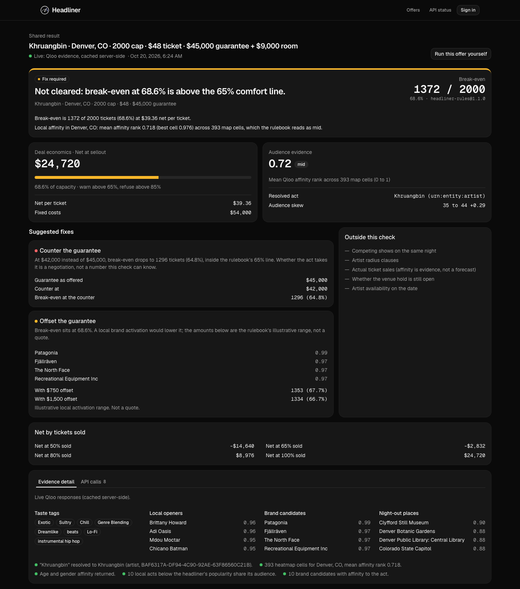

# Headliner

**Know whether the room makes sense before you sign the guarantee.**

An independent promoter looks at an offer sheet at 10 PM: an act, a city, a venue capacity, a ticket price and an artist guarantee. Once the hold confirms and the deposit wires, the risk is locked. Headliner checks the deal while the offer sheet is still on the desk.

Built for the [Qloo Agentic Hackathon](https://qloo.devpost.com) (Sep 30 – Oct 30, 2026). MIT licensed.

**Live:** https://headliner.carsonrodrigues.com, running on the Qloo API. No sign-in needed.
**All twelve offers checked live in one click:** https://headliner.carsonrodrigues.com/board?run=all



## What it does

Type the offer the way it arrives:

```
Japanese Breakfast · Austin, TX · 300 cap · $28 ticket · $3,500 guarantee + $1,200 room
```

Headliner answers with one of four statuses and shows its work:

| Status | Meaning |
|---|---|
| **Cleared** | The money works and the act has local affinity in that city. |
| **Fix required** | The money is tight or the market is weak; the smallest fix is shown (a counter-guarantee, a local opener, a sponsor offset, or a nearby city that reads better). |
| **Refused** | The arithmetic fails a rulebook rule. Taste does not override money, but the verdict still gives the guarantee to counter with. |
| **Abstained** | The signal cannot be established (no exact Qloo match for the act, or too few map cells). Headliner names what is missing, and Qloo's nearest miss, instead of guessing. |

Three things are kept strictly apart:

1. **Deterministic deal math** (`src/lib/deal/deal-math.ts`) against a versioned rulebook (`src/lib/rules/rules-v1.json`). Every dollar figure comes from here. No model touches arithmetic.
2. **Qloo cultural evidence** (`src/lib/qloo/`): exact-match entity resolution, affinity rank across the city's heatmap cells, over-indexing age bands, local openers, brand candidates, night-out places, taste tags. Every call is traced and shown. Affinity is evidence, never a ticket forecast.
3. **What the check cannot establish**: competing shows, radius clauses, actual sales, hold status, availability. Listed on every result.

## Why Qloo

Without Qloo the second column does not exist. A language model can tell you Austin likes live music; it cannot tell you whether *this* act has affinity in *this* metro, which local acts share its audience, or which brands its fans already buy. The "Without Qloo" control runs the same offer through a model alone and measures the overlap. On the twelve pre-seeded offers it was 1% on openers and 1% on sponsors, the model read no real market as weak where Qloo read four, and it named sponsors for acts that do not exist (details in DEVPOST.md). It runs with `ANTHROPIC_API_KEY`, `AI_GATEWAY_API_KEY` or `OPENROUTER_API_KEY`.

## Running it

```bash
pnpm install
cp .env.example .env   # add QLOO_API_KEY when you have one
pnpm dev
```

Without a key the app runs in **sample mode** and says so on every screen. Sample evidence is illustrative and labelled; it is not Qloo data.

With a key, `pnpm probe`, `pnpm calibrate` and `pnpm offers` reproduce every number in DEVPOST.md (see Key-day scripts below).

Qloo responses are cached server-side (allowed by the hackathon terms, no time limit) and are never committed.

## Scenario compare

Every fix carries a one-click scenario: swap the market to the compared metro, put the suggested opener on the bill, or apply the rulebook's sponsor offset. The desk runs the changed offer as a second queued check and shows the two verdicts side by side with a deterministic list of what changed and why (`src/lib/verdict/diff.ts`). On the live API a combined bill becomes the signal for the market reads; in sample mode the opener scenario says plainly that it cannot be evaluated.

## The board and share links

- **/board**: every pre-seeded offer on one fixed-column board. Run them all and each row settles with its break-even, signal and verdict badge; a tally counts cleared, fix required, refused and abstained. Clicking an act prefills the desk.
- **Share a verdict**: a finished check becomes a link at `/s/<id>`, stored in the headliner Supabase stack through PostgREST with the service role (row-level security on, no anon policy, soft delete). Without `SUPABASE_SERVICE_ROLE_KEY` the store is in memory.

## For judges and counterparties

- **/suite**: runs every Qloo endpoint Headliner depends on, once, live, and shows status, latency and result counts. In sample mode it says nothing was called.
- **MCP server** (read-only): a venue booker's or sponsor's agent can run the same check and read the same evidence, rulebook and trace.

  ```bash
  pnpm mcp                      # stdio transport
  node scripts/mcp-smoke.mjs    # initialize, list tools, run check_offer
  ```

  Tools: `check_offer(line)`, `rulebook()`, `endpoint_suite()`.
- **Market swap**: when the primary city reads weak, the same act is checked in a configured nearby metro (`src/lib/geo/nearby.ts`) and the two heatmaps are shown side by side with the shared taste tags from `/v2/analysis/compare`. If the alternative is too sparse to compare, the result says so and makes no claim.

## Accounts, queue, pages

- **Accounts** (optional): Supabase Auth with Google, Apple and email, cookie sessions refreshed in `src/proxy.ts`. Set `NEXT_PUBLIC_SUPABASE_URL` and `NEXT_PUBLIC_SUPABASE_ANON_KEY`; without them the desk runs and account links are hidden. Apple on web needs `NEXT_PUBLIC_AUTH_APPLE=true` once the Services ID is configured in Supabase.
- **Queued checks**: `POST /api/jobs` returns a job id at once; the desk polls `GET /api/jobs/:id` and the id rides in the URL hash so a refresh resumes. The in-memory worker (`src/lib/jobs/store.ts`) is the development implementation behind a store interface.
- **Pages**: `/terms`, `/privacy`, `/cookies`, `/support` (FAQ with schema.org), `/contact` (Resend when `RESEND_API_KEY` and `CONTACT_FROM` are set), `/llms.txt`, `/robots.txt`, `/sitemap.xml`, `/.well-known/security.txt`.

## Key-day scripts

With `QLOO_API_KEY` in `.env`:

- `pnpm probe` checks every endpoint against 20 acts (15 real, 5 invented) and prints resolution and coverage counts.
- `pnpm calibrate` measures mean affinity rank for 15 acts in 5 cities; the rulebook's cut-offs are its tertiles.
- `pnpm offers [--baseline]` runs all twelve pre-seeded offers through the site's own check and prints the tally.

Raw responses go to `.cache/` (git-ignored). DEVPOST.md records what the first live run got wrong and how each finding was fixed.

## Design

shadcn/ui (style `base-nova`, Base UI primitives, neutral palette) with Geist Sans for interface text and Geist Mono for every number, id and parameter. Components under `src/components/ui/` are owned source added with the shadcn CLI; the product components compose them. Colour is reserved for state: four status tones (`success`, `warning`, `destructive`, `info`) map one-to-one onto the four verdict statuses in `src/lib/enums.ts` and are always paired with a text label. Tokens live in `src/app/globals.css`; the `.dark` class and the OS preference both switch the scene, and the account settings page overrides it. Contrast is measured with `node scripts/contrast.mjs`.

Motion (`src/components/motion/`) is small and functional: GSAP counts the break-even and affinity readings up to their exact values, reveals fixes on scroll and flips board rows in as checks land; Lenis smooth-scrolls the home and share pages. Every piece is off under `prefers-reduced-motion`.

## Deploy (Carson's VPS, behind the shared Caddy)

The VPS already runs one self-hosted Supabase stack per product under `/root/stacks/<name>` and a shared `supabase-caddy` that owns ports 80 and 443. Headliner follows the same pattern:

1. Create the `headliner` Supabase stack with the server's `new-stack.sh`; it provides the `headliner_default` network and `headliner-supabase-kong`.
2. Append `deploy/Caddyfile.snippet` to `/root/supabase/docker/Caddyfile`, validate, connect Caddy to `headliner_default`, reload.
3. Add two A records to the VPS: `headliner.carsonrodrigues.com` and `headliner-api.carsonrodrigues.com`.
4. Fill `/opt/headliner/.env` from `.env.example` (Qloo key, Supabase URL and anon key of the new stack, optional gateway and Resend keys).
5. `SSH_HOST=root@<vps> ./deploy/deploy.sh` builds the image on your machine for the server's architecture, ships it over SSH, and starts `headliner-app` on the stack's network with a 512 MB memory ceiling.

Never build on the VPS. It shares RAM with other production stacks, and a Next.js build peaks at one to two GiB. Public Supabase settings reach the browser from the server at request time, so the image carries no environment-specific values and the same image runs anywhere.

## Security (OWASP Top 10 pass, 2026-10-17)

- **A01 access control**: no accounts, no user-owned records; nothing to escalate. Share links (planned) use unguessable ids.
- **A02 cryptographic failures**: the Qloo key and gateway key live only in server env; the pipeline is `server-only`; the key is never in a URL, a response, a trace or a log. HSTS is set.
- **A03 injection**: every request body is parsed as JSON, validated with Zod, length-capped; the offer line is bounded to 500 characters. Qloo parameters are sent as URL query values, never interpolated into paths.
- **A04 insecure design**: per-client rate limits (30 checks/min, 10 model baselines/min, 5 suite runs/min), 4 KB body cap, same-origin check on POSTs, abstention instead of guessing. Limits are per server instance; on multi-instance hosting they bound abuse per instance.
- **A05 misconfiguration**: nonce-based CSP with `strict-dynamic` (`src/proxy.ts`), `X-Content-Type-Options`, `X-Frame-Options`, `Referrer-Policy`, `Permissions-Policy`, COOP, no `X-Powered-By`, `Cache-Control: no-store` on APIs. Verified in the browser with no CSP violations in dev.
- **A06 vulnerable components**: `pnpm audit --prod` runs in CI; lockfile committed; no third-party scripts, fonts self-hosted.
- **A07 authentication**: not applicable by design (no-login sandbox); revisit with persisted share links.
- **A08 integrity**: no CDN scripts; dependencies pinned by lockfile; rulebook versioned and stamped on every verdict.
- **A09 logging**: rejected requests and failures are logged as structured JSON with a hashed client key, never a raw IP or offer text.
- **A10 SSRF**: the Qloo client refuses any base URL that is not an https `qloo.com` host.
- `/.well-known/security.txt` carries the contact.

## Checks

```bash
pnpm lint        # Biome
pnpm typecheck   # tsc --noEmit
pnpm test        # Vitest
```

## Status

See `FEATURE-REGISTER.md` for what is built, how each part was verified, and what is deliberately out of scope.

## Support

carson@celabe.com
